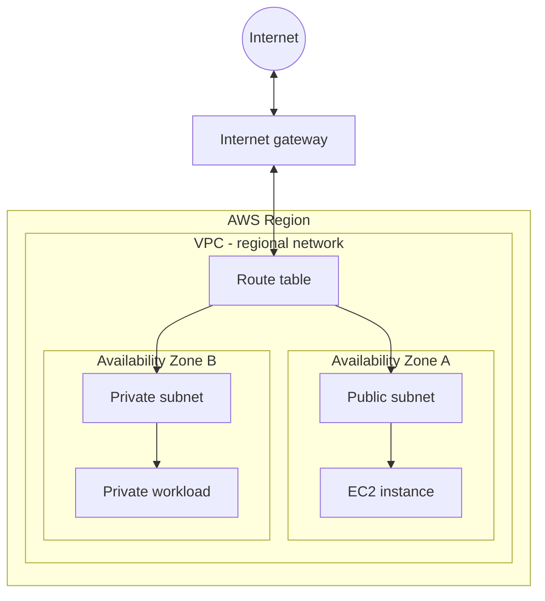
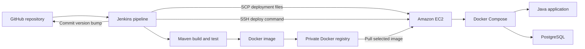

# AWS Services

**Projects:** Deployed a containerized application to Amazon EC2 manually and from Jenkins, complete the CI/CD pipeline with Docker Compose and dynamic versioning, manage AWS resources with the AWS CLI, and push a Docker image to Amazon ECR.

**Technologies used:** AWS, Microsoft Azure, Amazon EC2, Amazon ECR, IAM, VPC, AWS CLI, Jenkins, Docker, Docker Compose, Linux, Git, GitHub, Java, Maven

**Project description:**

- Learn the AWS resource hierarchy: global services, Regions, and Availability Zones
- Use IAM identities, groups, roles, and policies to control access
- Understand VPCs, subnets, CIDR blocks, internet gateways, network ACLs, and security groups
- Launch an EC2 instance and deploy a Docker image from a private registry
- Configure a Jenkins pipeline to deploy to EC2 automatically over SSH
- Replace inline remote commands with Docker Compose and a deployment shell script
- Build, tag, authenticate, and push a Docker image to Amazon ECR
- Install and configure the AWS CLI and use it to inspect and create resources

---

## Description

This repository holds the application and pipeline code for my AWS Services project. It demonstrates a complete CI/CD workflow in which Jenkins builds and publishes the application, connects to an Amazon EC2 instance, transfers deployment files and starts the new application version with Docker Compose. My setup is multi-cloud: Jenkins runs in Docker on a Microsoft Azure VM and the application is deployed to AWS EC2. Images are published to Docker Hub. The sample applications and starting pipeline come from a simple application from an online resource. I built the infrastructure on both clouds, adapted the pipeline to my accounts and documented the problems I solved along the way.

The progression of my project is preserved in separate branches:

- `main` contains the AWS CLI command reference and example applications.
- `feature/payment` demonstrates the first automated EC2 deployment with `docker run`.
- `jenkins-jobs` contains the complete CI/CD pipeline with Maven versioning, Docker build and push, remote Docker Compose deployment and Git write-back.

**Amazon ECR** is covered as a separate registry exercise. The end-to-end Jenkins example currently uses Docker Hub through the external Jenkins Shared Library.

## Source material

This documentation is based on:

- The code and Git history in this repository

AWS's Free Tier structure has changed. For AWS accounts created on or after July 15, 2025, AWS currently describes a credit-based free plan that ends after six months or when its credits are exhausted. Always check the current offer, create a budget, and delete lab resources when finished.

---

### Architecture

AWS (deployment target)
**Region:** `eu-north-1 (Stockholm)`, using the default VPC and a public subnet
**EC2:** `t3.micro` running Amazon Linux, with Docker and Docker Compose installed
**Access:** connected over SSH with an EC2 key pair. The private key never leaves my Mac and the Jenkins credentials store.
**Security group:** SSH (22) allowed only from my IP and the Jenkins server's IP. Application ports are opened only while a demo needs them.
**Identity:** I sign in to the console with my own login, not the root user. An IAM user with an access key is used only for the AWS CLI.

### Azure (Jenkins server)
- **VM:** Ubuntu 24.04 LTS, Standard_B2s (2 vCPU, 4 GiB) in Denmark East, created with the Azure CLI
- **Network security group:** SSH (22) and Jenkins (8080) allowed only from my IP
- **Public IP:** static, so the Jenkins URL stays the same when the VM is stopped and started
- **Jenkins:** jenkins/jenkins:lts in Docker with a named volume for Jenkins home and the unless-stopped restart policy. It reaches the host's Docker daemon through the mounted Docker socket.

Because port 8080 only accepts my IP, GitHub webhooks can't reach Jenkins, so builds are started with Build Now.

### Resource scope

AWS resources do not all have the same scope:

| Scope | Meaning | Examples in this module |
|-------|---------|-------------------------|
| **Global** | Available across the AWS account rather than selected in one Region | IAM |
| **Region** | A geographic area containing multiple Availability Zones | VPC, ECR repository |
| **Availability Zone** | One or more discrete data centers within a Region | Subnet, EC2 placement |

Choose the Region deliberately. Resources in different Regions are separate, and the AWS CLI and console only show many regional resources for the currently selected Region.

### IAM

AWS Identity and Access Management controls who or what can perform actions on AWS resources:

| IAM object | Purpose |
|------------|---------|
| **User** | A long-lived identity for a specific use case |
| **Group** | A collection of IAM users that share permissions |
| **Role** | An assumable identity that provides temporary credentials |
| **Policy** | A JSON document defining allowed or denied actions, resources, and conditions |

For a modern setup:

- Protect the root user with MFA and do not use it for everyday administration.
- Do not create root access keys.
- Prefer IAM Identity Center or another federated identity provider for people.
- Prefer IAM roles and temporary credentials for workloads.
- Apply least privilege and remove unused permissions and credentials.

An IAM-user workflow remains useful for learning the IAM object model, but long-lived IAM access keys should be limited to cases that cannot use temporary credentials.

### VPC and subnet model

A Virtual Private Cloud is an isolated network within one AWS Region. A VPC can span all Availability Zones in that Region, but each subnet belongs to exactly one Availability Zone.



Important terms:

- **CIDR block:** the IP address range assigned to a VPC or subnet. A subnet CIDR must fit inside the VPC CIDR and must not overlap another subnet.
- **Internet gateway:** connects a VPC to the internet when the route table and resource addressing also permit it.
- **Public subnet:** has a route to an internet gateway. An instance also needs a public IPv4 address or IPv6 connectivity to communicate directly with the internet.
- **Private subnet:** has no direct route for unsolicited internet traffic. Outbound-only IPv4 access commonly uses a NAT gateway.
- **Network ACL:** stateless traffic filtering at the subnet boundary.
- **Security group:** stateful traffic filtering attached to resources such as EC2 network interfaces.

For this lab, restrict SSH port `22` to your workstation or Jenkins server public IP. Open the application port only to the audience that needs it. Do not expose PostgreSQL port `5432` to the internet.

---

## Demo project

### 1. Deploy a web application to EC2 manually

The first project establishes the deployment steps before automating them:

1. Select an AWS Region.
2. Launch a Linux EC2 instance in a VPC and subnet.
3. Select or create an EC2 key pair.
4. Configure a security group for SSH and the application port.
5. Connect to the instance over SSH.
6. Install and start Docker.
7. Authenticate to the private registry, pull the image, and run the container.
8. Open the application through the EC2 public DNS name or public IP.

On macOS or Linux, protect the downloaded private key:

```bash
chmod 400 ~/.ssh/YOUR_KEY.pem
```

Connect with the username required by the selected AMI:

```bash
ssh -i ~/.ssh/YOUR_KEY.pem ec2-user@YOUR_EC2_PUBLIC_DNS
```

Amazon Linux commonly uses `ec2-user`; Ubuntu AMIs commonly use `ubuntu`.

Example container deployment:

```bash
docker login
docker pull YOUR_REGISTRY/YOUR_IMAGE:YOUR_TAG
docker run -d --name demo-app -p 8080:8080 YOUR_REGISTRY/YOUR_IMAGE:YOUR_TAG
```

Do not share private keys. Each person should use an individually managed key or an approved access mechanism such as AWS Systems Manager Session Manager.

### 2. Deploy from Jenkins with `docker run`

The `feature/payment` branch demonstrates the first CD step. Jenkins uses the SSH Agent plugin and the `ec2-server-key` credential to execute `docker run` on a remote EC2 instance.

[View the `feature/payment` Jenkinsfile](https://github.com/ronkaiser/devops-09-aws-services/blob/feature/payment/java-maven-app/Jenkinsfile)

The branch maps EC2 host port `3000` to container port `3080`. Replace the checked-in lab IP address, image reference, and ports with values for your environment.

### 3. Deploy from Jenkins with Docker Compose

The `jenkins-jobs` branch evolves the deployment:

1. Jenkins determines the new image version.
2. Jenkins copies `server-cmds.sh` and `docker-compose.yaml` to EC2 with `scp`.
3. Jenkins connects to EC2 with SSH.
4. The script exports the pipeline-selected `IMAGE` value.
5. Docker Compose starts or updates the application and PostgreSQL services.

Branch files:

- [`Jenkinsfile`](https://github.com/Ryans-cloud-lab/AWS-Service/blob/jenkins-jobs/java-maven-app/Jenkinsfile)
- [`docker-compose.yaml`](https://github.com/ronkaiser/AWS-Service/blob/jenkins-jobs/java-maven-app/docker-compose.yaml)
- [`server-cmds.sh`](https://github.com/ronkaiser/AWS-Service/blob/jenkins-jobs/java-maven-app/server-cmds.sh)
- [`Dockerfile`](https://github.com/ronkaiser/AWS-Service/blob/jenkins-jobs/java-maven-app/Dockerfile)

### 4. Complete CI/CD pipeline

The final pipeline on `jenkins-jobs` implements:

| Stage | Purpose |
|-------|---------|
| **increment version** | Increment the Maven patch version and create `IMAGE_NAME` in `{version}-{BUILD_NUMBER}` format |
| **build app** | Run the shared-library `buildJar()` step to package the Java application |
| **build image** | Build the Docker image, authenticate to the registry, and push it |
| **deploy** | Copy deployment files to EC2 and run Docker Compose remotely |
| **commit version update** | Commit the changed `pom.xml` and push it to the `jenkins-jobs` branch |



This pipeline combines application build, container publishing and automated deployment to AWS.

### 5. Interact with AWS through the CLI

The CLI exercise covers EC2, IAM, VPC, subnet, security group, key-pair and policy operations.

Use a named profile so the lab configuration is explicit:

```bash
aws configure --profile devops
aws sts get-caller-identity --profile devops
aws configure list --profile devops
```

Then inspect resources:

```bash
aws ec2 describe-vpcs --profile devops
aws ec2 describe-subnets --profile devops
aws ec2 describe-security-groups --profile devops
aws ec2 describe-instances --profile devops
```

See the repository's [AWS CLI command reference](./cli-commands/aws-cli-commands.md) for the lecture commands. Replace every placeholder and review the selected account and Region before running commands that create, modify, or delete resources.

`aws configure` stores long-lived keys in plaintext files under `~/.aws`. Prefer `aws configure sso`, role-based credentials, or another temporary-credential method when available. Never commit `.aws` files, access keys, secret keys, or session tokens.

### 6. Push an image to Amazon ECR

Amazon Elastic Container Registry is AWS's managed container image registry. The course workflow is:

1. Create a private ECR repository.
2. Authenticate Docker to the regional ECR registry.
3. Build the Docker image.
4. Tag it with the ECR repository URI.
5. Push it.

```bash
aws ecr create-repository \
  --repository-name demo-app \
  --region YOUR_REGION \
  --profile devops

aws ecr get-login-password \
  --region YOUR_REGION \
  --profile devops\
  | docker login \
      --username AWS \
      --password-stdin YOUR_ACCOUNT_ID.dkr.ecr.YOUR_REGION.amazonaws.com

docker build -t demo-app:latest .

docker tag demo-app:latest \
  YOUR_ACCOUNT_ID.dkr.ecr.YOUR_REGION.amazonaws.com/demo-app:latest

docker push \
  YOUR_ACCOUNT_ID.dkr.ecr.YOUR_REGION.amazonaws.com/demo-app:latest
```

The ECR repository and login command must use the same Region. The IAM identity running these commands also needs permission to create or access the repository and upload image layers.

---

## Prerequisites

### AWS

- AWS account with MFA enabled for the root user
- A non-root administrative or lab identity
- An AWS Region selected for all regional resources
- A VPC and public subnet; the default VPC is sufficient for the introductory lab
- EC2 key pair
- EC2 security group with narrowly scoped inbound rules
- A budget or billing alert

### Local workstation

- Git
- Docker
- AWS CLI v2
- SSH client
- Java 17 and Maven for local Java builds

### Jenkins

- Jenkins server and agent
- Docker available to the Jenkins agent
- Maven configured in **Global Tool Configuration** with the name `Maven`
- **SSH Agent** plugin
- Access to the external `jenkins-shared-library` repository
- Credentials configured with the IDs below

---

## Jenkins configuration

### Credentials

| Credential ID | Jenkins type | Purpose |
|---------------|--------------|---------|
| `ec2-server-key` | SSH Username with private key | Connect from Jenkins to the EC2 deployment host |
| `docker-hub-repo` | Username with password | Registry login used by the Jenkins Shared Library |
| `github-credentials` | Username with password / personal access token | Load the Shared Library and push the Maven version update |

Use your GitHub username and a token with only the repository permissions required by the job. GitHub account passwords do not work for Git operations over HTTPS.

### EC2 security group

| Port | Source | Reason |
|------|--------|--------|
| `22/tcp` | Jenkins server public IP and, if required, your administration IP | SSH and SCP deployment |
| `8080/tcp` | Your IP for the lab, or the appropriate load balancer/client network | Java application on `jenkins-jobs` |
| `3000/tcp` | Your IP only when reproducing `feature/payment` | Early `docker run` demo |

Do not add an internet-wide SSH rule such as `0.0.0.0/0`. Security groups are stateful, so response traffic for an allowed connection is automatically permitted.

### EC2 host preparation

The remote host needs:

- Docker installed and running
- Docker Compose available
- The Jenkins SSH user permitted to run Docker
- Sufficient disk space for application and database images
- Registry credentials if the deployed image is private

Current systems generally use the `docker compose` command. The course branch uses the older `docker-compose` command, so either install the compatibility command or update `server-cmds.sh`.

---

## Repository branches

| Branch | Role |
|--------|------|
| **`main`** | AWS CLI notes and example applications; the Java Jenkinsfile is a stage placeholder |
| **`feature/payment`** | Initial remote deployment using Jenkins SSH Agent and `docker run` |
| **`jenkins-jobs`** | Complete dynamically versioned CI/CD pipeline with Docker Compose deployment to EC2 |

Clone a specific exercise branch with:

```bash
git switch feature/payment
```

or:

```bash
git switch jenkins-jobs
```

---

## Repository layout

```text
devops-09-aws-services/
├── README.md
├── cli-commands/
│   └── aws-cli-commands.md        # EC2 and IAM lecture commands
├── java-maven-app/
│   ├── Jenkinsfile               # Branch-dependent pipeline
│   ├── pom.xml                   # Java 17 Maven application
│   └── src/
├── java-react-example/            # Gradle/Spring and React example
├── js-app/                        # Dockerized Node.js/MongoDB example
└── react-nodejs-example/          # React frontend and Node.js API
```

The `jenkins-jobs` branch additionally contains `java-maven-app/Dockerfile`, `docker-compose.yaml` and `server-cmds.sh`.

---

## Before running the checked-in pipeline

The repository records course exercises, so several values are intentionally lab-specific. Review these before executing the pipeline:

1. **EC2 endpoint:** replace the hardcoded public IP with your instance DNS name or an injected Jenkins variable.
2. **SSH host verification:** the branch disables `StrictHostKeyChecking`. For a durable environment, add the verified EC2 host key to `known_hosts` instead.
3. **Docker image name:** use a fully qualified image such as `YOUR_DOCKERHUB_USER/demo-app:{version}-{BUILD_NUMBER}` or an ECR URI. Confirm that the Shared Library builds and pushes the same name that Compose receives.
4. **Dockerfile JAR name:** the branch copies `java-maven-app-1.1.0-SNAPSHOT.jar`, while the pipeline increments the Maven version. Make the artifact path dynamic or keep it synchronized with `pom.xml`.
5. **Git remote:** replace the hardcoded GitHub repository URL if working from a fork.
6. **Credentials:** confirm the three Jenkins credential IDs match your configuration.
7. **Database password:** replace the example PostgreSQL password in `docker-compose.yaml` with a managed secret.
8. **Compose port exposure:** PostgreSQL is mapped to host port `5432`; remove that mapping unless direct host access is required.
9. **Version-bump loop:** exclude automated `ci: version bump` commits from webhook builds or keep them on a controlled branch.

These changes preserve the learning workflow while avoiding stale endpoints, exposed credentials, and mismatched image or artifact names.

---

## Validation

### Verify AWS identity and Region

```bash
aws sts get-caller-identity --profile devops
aws configure get region --profile devops
```

### Verify EC2

```bash
aws ec2 describe-instances \
  --filters "Name=instance-state-name,Values=running" \
  --profile devops
```

### Verify the remote deployment

```bash
ssh -i ~/.ssh/YOUR_KEY.pem ec2-user@YOUR_EC2_PUBLIC_DNS
docker ps
docker compose -f docker-compose.yaml ps
curl http://localhost:8080
```

From your workstation, open:

```text
http://YOUR_EC2_PUBLIC_DNS:8080
```

If the application is not reachable, check:

- The EC2 instance is running and passed its status checks.
- The application container is healthy and bound to the expected host port.
- The security group allows the application port from your IP.
- The subnet route table and internet gateway support the intended connection.
- The instance has a public address when direct internet access is required.

---

## Cleanup

Cloud resources can continue to incur charges after the lab. When finished:

1. Terminate lab EC2 instances.
2. Delete unused EBS volumes and snapshots.
3. Delete unused ECR images and repositories.
4. Remove lab-only security groups, key pairs, IAM users, access keys, policies, and roles after confirming they are not shared.
5. Remove public IP resources and NAT gateways created for the lab.
6. Review AWS Billing and Cost Explorer for unexpected usage.
7. Remove obsolete Jenkins credentials and local private keys through your normal secure process.

Always inspect dependencies before deleting a VPC or IAM resource.

---


## References

### AWS documentation

- [AWS Free Tier](https://aws.amazon.com/free/)
- [IAM security best practices](https://docs.aws.amazon.com/IAM/latest/UserGuide/best-practices.html)
- [Root user best practices](https://docs.aws.amazon.com/IAM/latest/UserGuide/root-user-best-practices.html)
- [What is Amazon VPC?](https://docs.aws.amazon.com/vpc/latest/userguide/what-is-amazon-vpc.html)
- [VPC security groups](https://docs.aws.amazon.com/vpc/latest/userguide/vpc-security-groups.html)
- [Connect to a Linux EC2 instance with SSH](https://docs.aws.amazon.com/AWSEC2/latest/UserGuide/connect-linux-inst-ssh.html)
- [AWS CLI configuration and credential files](https://docs.aws.amazon.com/cli/latest/userguide/cli-configure-files.html)
- [Moving an image through its lifecycle in Amazon ECR](https://docs.aws.amazon.com/AmazonECR/latest/userguide/getting-started-cli.html)

### Related project

- [Jenkins Shared Library](https://github.com/ronkaiser/jenkins-shared-library)
