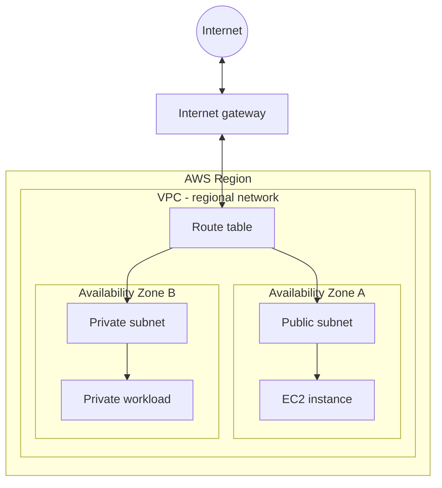

# AWS-Service
**Demo Project:** Deploy a containerised application to Amazon EC2, first manually and then automatically from Jenkins, with Docker Compose and dynamic versioning. Manage AWS resources with the AWS CLI and push an image to Amazon ECR.

**Technologies used:** AWS (EC2, ECR, IAM, VPC, AWS CLI), Microsoft Azure, Jenkins, Docker, Docker Compose, Linux, Git, GitHub, Java, Maven

**Project Description:**

- Learn the AWS resource hierarchy: global services, Regions and Availability Zones
- Use IAM users, groups, roles and policies to control access
- Understand VPCs, subnets, CIDR blocks, internet gateways, network ACLs and security groups
- Launch an EC2 instance and deploy a Docker image from a private registry
- Configure a Jenkins pipeline to deploy to EC2 automatically over SSH
- Replace inline remote commands with Docker Compose and a deployment shell script
- Build, tag, authenticate and push a Docker image to Amazon ECR
- Install and configure the AWS CLI and use it to inspect and create resources

## Description

This repository contains the application code and learning artifacts for Module 9 of the DevOps Bootcamp. It demonstrates a complete CI/CD workflow in which Jenkins builds and publishes the application, connects to an Amazon EC2 instance, transfers deployment files and starts the new application version with Docker Compose.

My setup is multi-cloud: Jenkins runs in Docker on a Microsoft Azure VM and the application is deployed to AWS EC2. Images are published to Docker Hub. I built the infrastructure on both clouds and adapted the pipeline to my accounts.

The course progression is kept in separate branches:

- `main` contains the AWS CLI command reference and example applications.
- `feature/payment` demonstrates the first automated EC2 deployment with `docker run`.
- `jenkins-jobs` contains the complete CI/CD pipeline with Maven versioning, Docker build and push, remote Docker Compose deployment and Git write-back.

### VPC and subnet model

A Virtual Private Cloud is an isolated network within one AWS Region. A VPC can span all Availability Zones in that Region, but each subnet belongs to exactly one Availability Zone.

